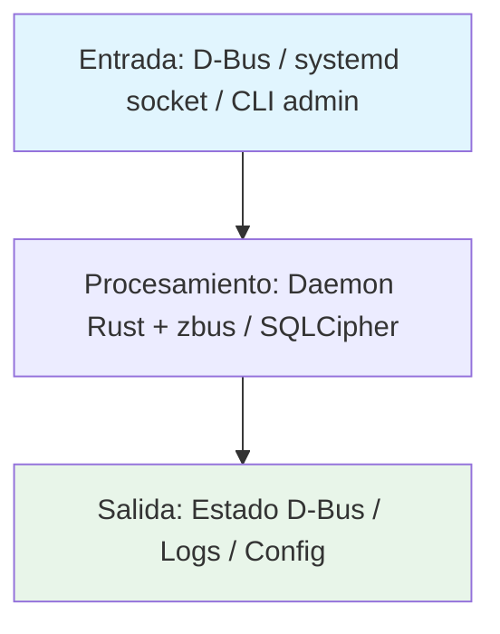

# Vasak keyring

Llavero nativo de VasakOS. Reemplazo de gnome-keyring con cifrado AES-256-GCM y derivación de clave Argon2id.

---

## Tecnología

[](https://www.rust-lang.org/) [](https://systemd.io/) [](https://dbus.freedesktop.org/) [](https://github.com/dbus2/zbus)

## Estado

[](https://github.com/Vasak-OS/vasak-keyring/actions/workflows/ci.yml)
[](https://github.com/Vasak-OS/vasak-keyring/releases)
[](LICENSE)
[](https://sonarcloud.io/summary/new_code?id=Vasak-OS_vasak-keyring)
[](https://sonarcloud.io/summary/new_code?id=Vasak-OS_vasak-keyring)
[](https://github.com/Vasak-OS/vasak-keyring)

---

## Descripción

Llavero nativo de VasakOS. Reemplazo de gnome-keyring con cifrado AES-256-GCM y derivación de clave Argon2id.

**Para el usuario:** 

**Integración VasakOS:** Integra con el ecosistema VasakOS vía D-Bus y configuración compartida.

---

## Arquitectura (diagramas)

### Flujo de datos



### Componentes internos

```mermaid
flowchart LR
    subgraph App[Vasak keyring]
        UI[(sin frontend — servicio headless)]
        Core[Daemon Rust: lógica principal + D-Bus]
        IPC[zbus / D-Bus]
    end
    UI --> IPC
    IPC --> Core
    Core --> DBus[(D-Bus / zbus)]
    Core --> System[systemd / D-Bus / SQLCipher (según servicio)]
    style UI fill:#f3e5f5
    style Core fill:#e3f2fd
    style DBus fill:#fff3e0
    style System fill:#fce4ec
```

### Integración en el sistema VasakOS

```mermaid
C4Context
    title Vasak keyring en VasakOS
    Person(usuario, "Usuario", "Persona que usa el sistema")
    System_Boundary(c1, "VasakOS") {
        System(app, "Vasak keyring", "Servicio del sistema Llavero nativo de VasakOS. Reemplazo de gnome-keyring con ci")
        System_Ext(accounts, "vasak-accounts", "Cuentas e identidad")\n        System_Ext(permissions, "vasak-permissions", "Permisos y portales")
    }
    System_Ext(systemd, "systemd", "Gestión de servicios + socket activation")
    System_Ext(dbus, "D-Bus sistema/sesión", "Bus de mensajes")
    Rel(usuario, app, "Usa")
    Rel(app, keyring, "Guarda/lee secrets")
    Rel(app, accounts, "Identidad de cuenta")
    Rel(app, systemd, "Socket-activated via D-Bus")
    Rel(app, dbus, "Expone org.vasak.Vasak-keyring")
```

---

## Instalación

### Arch Linux (repo oficial)

```bash
pacman -S vasak-keyring
```

### Debian / Ubuntu (.deb)

```bash
wget https://github.com/Vasak-OS/vasak-keyring/releases/download/v{{VERSION}}/vasak-keyring_{{VERSION}}_amd64.deb
sudo apt install ./vasak-keyring_{{VERSION}}_amd64.deb
```

### Desde fuente

```bash
git clone https://github.com/Vasak-OS/vasak-keyring.git
cd vasak-keyring

# Build completo
cargo build --release --locked

# Instalar binario
cargo install --locked --path .
```

---

## Uso rápido

```bash
# Se ejecuta como servicio systemd (socket-activated via D-Bus)
# No se lanza manualmente normalmente.
# Para debugging:
cargo run --bin vasak-keyring
```

### Atajos / flags principales

| Acción | Comando / Tecla |
|--------|-----------------|
| Acción principal | `vasak-keyring` |
| Configuración | `vasak-keyring --config` |
| Ayuda | `vasak-keyring --help` |

> **Captura:** `assets/demo.gif` *(placeholder — sustituir por GIF real)*

---

## Configuración

### Archivo de configuración

```
/etc/vasak/keyring.toml  (sistema)
~/.config/vasak/keyring.toml  (usuario, si aplica)
```

> Servicios de sistema usan `/etc/vasak/`, configuración de usuario en `~/.config/vasak/`.

### Variables de entorno

| Variable | Descripción | Por defecto |
|----------|-------------|-------------|
| `VASAK_DEBUG` | Activa logs de depuración en consola | `false` |
| `RUST_LOG` | Nivel de log (trace, debug, info, warn, error) | `info` |

### Integración con `tauri-plugin-config-manager`

(servicio headless — sin integración config-manager)

---

## Desarrollo

### Requisitos

- **Rust:** `rustup` toolchain estable (`rust-toolchain.toml` fija la versión)
- **Node / bun:** `bun` ≥ 1.1 (nunca npm/yarn/pnpm para apps Tauri)
- **Sistema:** `pkg-config`, `libgtk-3-dev`, `libwebkit2gtk-4.1-dev`, `libssl-dev`
- *`libdbus-1-dev`, `libsystemd-dev` para systemd, `libsqlcipher-dev` si usa SQLCipher*

### Dependencias de desarrollo

#### Sistema (paquetes Arch / Debian / Fedora)

`base-devel`, `pkgconf`, `libssl-dev`, `libwebkit2gtk-4.1-dev`, `libgtk-3-dev`, `libayatana-appindicator3-dev`, `librsvg2-dev`, `gstreamer1.0-plugins-base`, `gstreamer1.0-plugins-good`, `libpipewire-0.3-dev`, `libwireplumber-0.5-dev`, `libdbus-1-dev`, `libudev-dev`, `libxkbcommon-dev`, `libwayland-dev`, `meson`, `ninja`, `clang`, `lld`

#### Rust

`rustup` → `stable` + `rustfmt` + `clippy`

#### Node

**Solo `bun`** (nunca npm/yarn/pnpm para apps Tauri). `bun --version` ≥ 1.1

#### Herramientas CLI

`just` (command runner), `cargo-binstall` (opcional), `cargo-llvm-cov` (para cobertura)

### Correr en desarrollo

```bash
# Backend con recarga en caliente
cargo watch -x "run --bin vasak-keyring`

# Solo tests
cargo test --locked
```

### Compilar / Build de release

```bash
# Build release optimizado
cargo build --release --locked

# Instalar
cargo install --locked --path .

# Paquetes nativos
# Arch: makepkg -sf en PKGBUILDS/vasak-keyring/
# Debian: cargo deb --no-build --target-dir target/release/debian
```

### Targets principales

```bash
# Desarrollo
cargo watch -x "run --bin vasak-keyring"

# Build producción
cargo build --release --locked

# Solo frontend
(no aplica — sin frontend)

# Solo backend Rust
cargo build --release --locked

# Lint + tipos (pre-commit / CI)
cargo fmt --check
cargo clippy -- -D warnings
```

### Pruebas

```bash
# Suite completa Rust
cargo test -p vasak-keyring -p vasak-keyring-lib --locked

# Tests de integración (requieren D-Bus)
cargo test -p vasak-keyring-integration --locked -- --ignored
```

### Convención de commits

[Conventional Commits](https://www.conventionalcommits.org/es/v1.0.0/):

```
<tipo>(<ámbito>): <descripción corta>

[cuerpo opcional]

[pie opcional: Closes #N]
```

Tipos habituales: `feat`, `fix`, `bugfix`, `docs`, `ci`, `chore`, `security`, `refactor`, `perf`, `test`.

### Cómo abrir PR

1. Rama desde `origin/main`:
   ```bash
   git worktree add -b feat/{{TEMA}} ~/wt/vasak-keyring-{{TEMA}} origin/main
   ```
2. Prefijos de rama: `fix/`, `feat/`, `bugfix/`, `docs/`, `ci/`, `chore/`, `security/`
3. Escribe el fix → **`qa` escribe las pruebas** (fallan sin el fix) → suite verde → abre PR
4. Al abrir PR, **cuatro cosas obligatorias**:
   - Asignado a `JoaquinDecima`
   - Etiqueta `enhancement` o `bug` (+ `ci` / `dependencies` si aplica)
   - Añadido al proyecto «VasakOS Roadmap»
   - Status **In Progress**

---

## Arquitectura (texto)

### Crates / módulos principales

| Crate / Módulo | Responsabilidad |
|----------------|-----------------|
| `vasak-keyring` | Binario principal / daemon systemd |
| `vasak-keyring-lib` | Lógica compartida / biblioteca pública |

### Interfaces D-Bus / zbus expuestas

| Interfaz | Métodos / Señales / Propiedades | Descripción |
|----------|----------------------------------|-------------|
| `org.vasak.Vasak-keyring` | `GetStatus()`, `StatusChanged(dict)`, `Reload()`, `GetConfig()` | Control y estado del servicio |
| `org.vasak.Vasak-keyring.Admin` | `SetPolicy(dict)`, `AuditLog()` | API administrativa (solo root) |

### Puntos de extensión

- **Plugins:** Sistema de plugins modular
- **Hooks:** Hooks de ciclo de vida
- **API pública Rust:** API pública del crate principal

### Features / Cargo features

| Feature | Descripción | Default |
|---------|-------------|---------|
| `systemd` | Integración systemd (socket activation) | ✓ |
| `tracing` | Logging estructurado con tracing | ✓ |
| `admin` | API administrativa (solo root) | |
| `pam` | Módulo PAM para autenticación | |


---

## Pruebas y calidad

- **Cobertura objetivo:** ≥ 80 % del código nuevo (SonarCloud Quality Gate)
- **Informes:** GitHub Actions → pestaña *SonarCloud Code Analysis* → enlace a SonarCloud
- **Añadir pruebas:** ver `AGENTS.md` sección 9 (mapa de repos y comandos de prueba)
- **Regla:** toda corrección lleva prueba escrita por `qa` que falla sin el fix

---

## Contribuir

- **Guía:** [CONTRIBUTING.md](https://github.com/Vasak-OS/.github/blob/main/CONTRIBUTING.md)
- **Plantillas de issue:** [ISSUE_TEMPLATE](https://github.com/Vasak-OS/.github/tree/main/ISSUE_TEMPLATE)
- **Código de conducta:** [CODE_OF_CONDUCT.md](https://github.com/Vasak-OS/.github/blob/main/CODE_OF_CONDUCT.md)

---

## Contribuidores

> **Actualizado automáticamente en CI** — muestra los avatares de quienes han aportado código a este repo.

<div align="center">
  <a href="https://github.com/JoaquinDecima" target="_blank"></a>
</div>

[Ver todos los contribuidores](https://github.com/Vasak-OS/vasak-keyring/graphs/contributors)

---

## Donadores / Sponsors

[](https://github.com/sponsors/Vasak-OS)

> **Backers:** *Actualizado automáticamente en CI desde GitHub Sponsors / OpenCollective / Polar.*

[💖 Donar al proyecto](https://github.com/sponsors/Vasak-OS)

---

## Licencia

`MIT` — Copyright © 2026 **Vasak-OS Contributors**

[Ver licencia completa](LICENSE)
